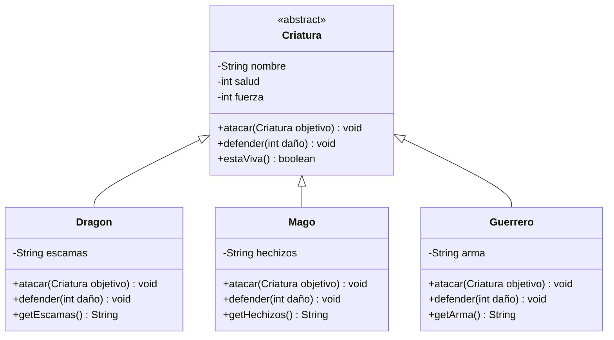

# Parcial II - Batalla de Criaturas

Proyecto de Programación II (G411). Juego de batallas por turnos entre criaturas, hecho en Java con **polimorfismo** y **clases abstractas**.

## Integrantes
- Daniel Ricardo Toro ibarguen
- Daniel Rubio

## Estructura del proyecto

| Archivo | Descripción |
|---|---|
| `Criatura.java` | Clase abstracta con `nombre`, `salud`, `fuerza`, los métodos abstractos `atacar` y `defender`, y el método concreto `estaViva()` |
| `Dragon.java` | Ataca con `fuerza * 2` y se defiende con sus escamas |
| `Mago.java` | Ataca con hechizos y se defiende con una barrera mágica |
| `Guerrero.java` | Ataca con su arma y se defiende con un escudo |
| `Main.java` | Método `simularBatalla` y creación de criaturas |

## Conceptos aplicados
- Clases abstractas y métodos abstractos
- Herencia y sobrescritura de métodos (`@Override`)
- Polimorfismo: `simularBatalla` trabaja con el tipo genérico `Criatura`
- Encapsulamiento con atributos privados, getters y setters

## Cómo ejecutarlo
Requiere tener el JDK instalado (Java 17 o superior). Desde la carpeta del proyecto:

```
javac -encoding UTF-8 *.java
java Main
```

## Flujo de trabajo en Git
Cada integrante trabajó en ramas propias (`feature-...`), con commits individuales y pull requests aprobados por el compañero antes del merge.


## Diagrama de clases



